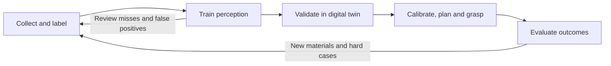

# SortSmart: AI-Powered Robotic Recycling

SortSmart is a closed-loop perception-to-action system for robotic material recovery. The current prototype uses discarded AAA batteries as the first target, then reuses the same data, perception, digital-twin and manipulation stack for new recyclable materials.

This repository contains the code used for the NVIDIA/Rockwell Automation Physical AI Hackathon: dataset preparation and YOLO instance-segmentation training, an NVIDIA Isaac Sim digital twin, calibrated grasp planning, and a guarded physical-robot policy for the FANUC ER-4iA cell.

## Why it matters

Waste streams are visually diverse, hazardous and constantly changing. Batteries are a useful first case because removing them protects downstream recycling equipment and enables recovery of valuable materials. SortSmart is designed as a scalable loop: new examples and failure cases update the dataset, model and simulated scenarios before the next physical deployment.

## System overview



Runtime perception follows one explicit path:

**Camera RGB → YOLO instance mask → calibrated center and yaw → safety gates → grasp and placement**

The robot controller does not use hidden simulator object poses. Isaac Sim ground truth is reserved for evaluation. The physical policy additionally gates motion with calibrated table/wrist depth and robot-self filtering.

## Measured results

### Perception A/B test

The fine-tuned model was evaluated against the baseline on five held-out robot-camera views containing 40 annotated batteries.

| Metric | Baseline | Fine-tuned |
|---|---:|---:|
| True positives | 26 | 38 |
| False positives | 2 | 1 |
| False negatives | 14 | 2 |
| Precision | 92.9% | 97.4% |
| Recall | 65.0% | 95.0% |
| F1 score | 76.5% | 96.2% |
| Mean confidence on correct detections | 73.8% | 82.7% |
| Image-cluster bootstrap 95% CI | 62.6–78.4% | 75.4–89.2% |

Missed batteries fell from 14 to 2 (an 86% reduction). The held-out views came from one robot episode, so the confidence interval is descriptive rather than a claim of production-scale generalization.

### Digital-twin validation

| Result | Value |
|---|---:|
| Randomized end-to-end trials | 12/12 successful |
| Wilson 95% CI for success rate | 75.8–100% |
| Pickup / carry / placement | 12/12 at every stage |
| Amazon Basics | 6/6; mean selected confidence 87.1% |
| 24/7 Life | 6/6; mean selected confidence 86.5% |
| Camera selection | table 11, wrist fallback 1 |
| Safety/quality gates | all passed |

Real-cell tests localized and grasped an AAA battery. The smooth stock fingers then lost the battery, identifying end-effector friction—not perception or target localization—as the immediate hardware limitation.

More detail and statistical caveats are in [docs/RESULTS.md](docs/RESULTS.md).

## Repository layout

| Path | Purpose |
|---|---|
| `training/` | Data preparation, LabelMe/YOLO conversion, training and evaluation |
| `digital_twin/` | Isaac Sim scenes, photo-derived battery visuals, YOLO IPC, planning and validation sweeps |
| `physical_robot/` | `uv` client, calibrated depth safety, guarded AAA pick/place policy and tests |
| `models/` | Final fine-tuned YOLO segmentation checkpoint and model card |
| `docs/` | Architecture, results and reproducibility notes |

Raw images, LabelMe annotations, videos, virtual environments and generated experiment runs are intentionally excluded from Git. They may contain large files or cell-specific data.

## Quick start

### 1. Assemble and verify the checkpoint

```bash
./models/assemble_checkpoint.sh
sha256sum models/aaa_yolo26s_best.pt
# 486c8599d8558b7826b9361f19b60bb67d3daf911f1d518436f2726c6bd01643
```

The checkpoint is stored as Git-friendly binary parts. The assembly script reproduces the original 23,386,909-byte file and refuses to continue if its SHA-256 is incorrect.

### 2. Run the digital-twin pipeline

The external YOLO worker and Isaac Sim run in separate terminals. Adjust `ISAAC`, the model path and the IPC directory for your installation.

```bash
# Terminal A: an environment with Ultralytics and CUDA
python digital_twin/yolo_ipc_worker.py \
  --model models/aaa_yolo26s_best.pt \
  --ipc-dir "$PWD/runs/yolo_ipc"

# Terminal B: Isaac Sim container/environment
cd digital_twin
ISAAC=/isaac-sim IPC_DIR="$PWD/../runs/yolo_ipc" \
  ./run_yolo_pick_place_sweep.sh ../runs/pick_place_sweep
```

For the five-battery clutter scene and MP4 output, see [digital_twin/README_rgb_pile_aware_multi_pick_v13.md](digital_twin/README_rgb_pile_aware_multi_pick_v13.md).

### 3. Check the physical-cell client locally

```bash
cd physical_robot
uv sync
uv run run.py --mock --trials 1 --trial-s 8
```

Running on a real robot requires the approved cell service, current camera calibration, an unobstructed workspace, supervised operation and functional emergency stops. See [physical_robot/docs/README_PHYSICAL_PICK_PLACE_V10_CN.md](physical_robot/docs/README_PHYSICAL_PICK_PLACE_V10_CN.md).

## Limitations and next steps

- The detector is currently trained for AAA batteries; additional battery types and recyclable materials require representative positive and negative samples.
- Heavy occlusion, damaged objects and domains outside the collected phone/robot-camera data need further validation.
- The stock gripper fingers need rubberized or 3D-printed high-friction contact surfaces for reliable cylindrical-object retention.
- The 12/12 simulation result is promising but small; broader randomized trials and repeated physical-cell tests are required.
- Long term, the digital twin can serve as the safe training and validation sandbox, while an operational ontology coordinates facility-wide material flows, resources, exceptions and human approvals.

## Team and acknowledgements

**Team SortSmart** — Physical AI Hackathon for the Factory Floor, 2026.

Built with NVIDIA DGX Spark, NVIDIA Isaac Sim, Ultralytics YOLO, Python/OpenCV and a FANUC ER-4iA cell. The project was developed as a three-week engineering prototype.

