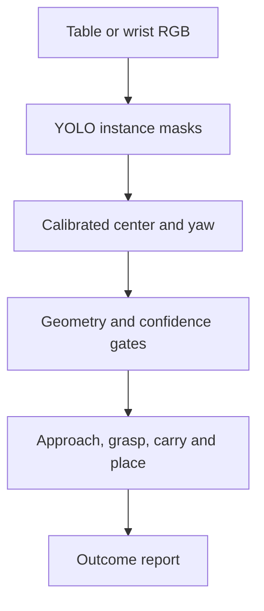
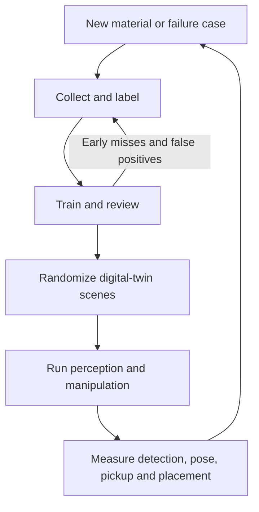

# Architecture and data loop

SortSmart separates perception, calibrated geometry, safety and motion so that each stage can be measured and replaced independently.

## Runtime path

The table camera provides the primary wide-area observation. A fixed safe wrist-camera scan is used when the table view cannot produce a confident, geometry-valid battery candidate. Depth is an independent safety cue: it validates the table plane, estimates obstacle clearance and supports robot-self filtering. It does not replace RGB instance recognition.

## Development loop

The inner review loop improves the dataset before robot execution. The outer loop adds new materials, visual domains and manipulation evidence, allowing the system to adapt rather than remain a one-object demo.

## Digital-twin boundary

- Real battery photographs are converted into cylindrical wrapper textures instead of using a plain colored cylinder.
- Isaac Sim supplies rendering, kinematics, contact and evaluation ground truth.
- Simulator object pose is not used to select grasp targets.
- External YOLO masks plus calibrated camera geometry produce control coordinates.
- Reports retain simulator truth only for error measurement and regression testing.

## Physical-cell boundary

- The submitted `physical_robot/policy.py` is the guarded AAA pick/place policy used before the later AA experiment.
- Motion is fail-closed when calibration, confidence, workspace or depth-clearance gates are invalid.
- Calibration must be repeated after any camera, table, tool or robot-frame change.
- Physical operation must be supervised and use the cell's safety systems.

